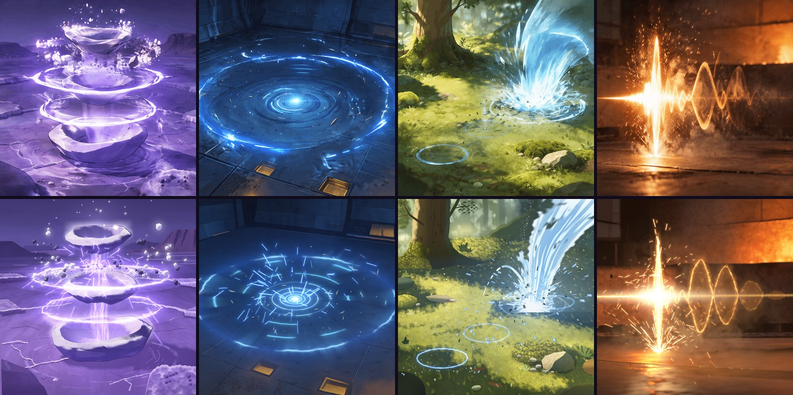
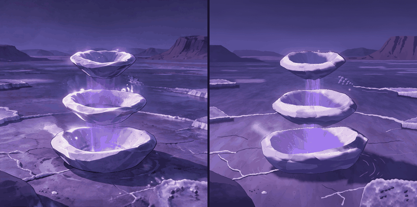
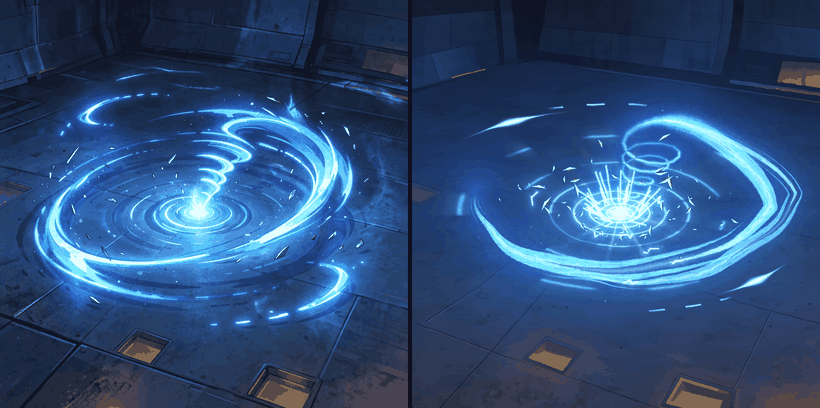
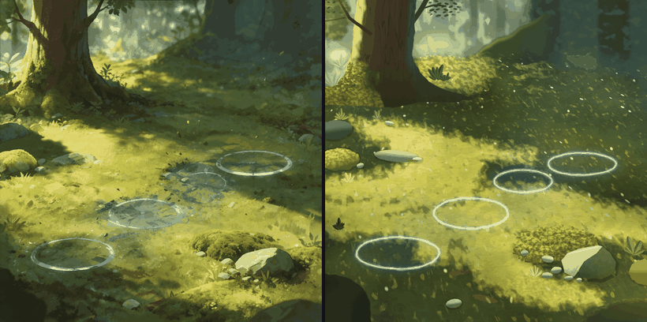
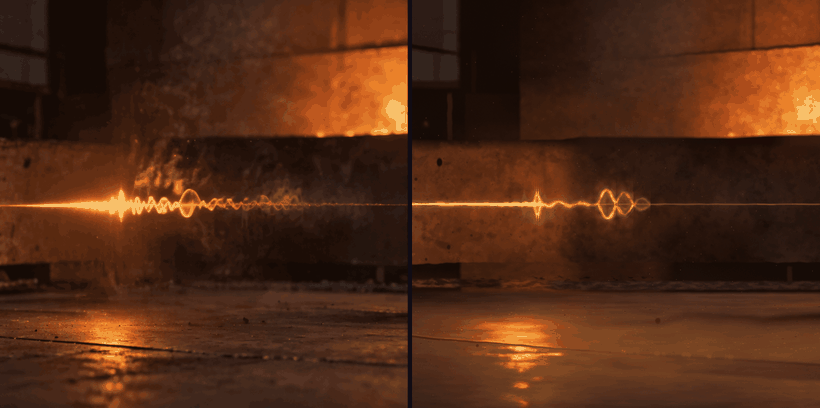

# AnyVFX: effect clips rebuilt as shaders by an agent

Give it a short clip of an effect (a looping GIF: a beam, a shock ring, a splash, sparks, dust) and it writes one
fragment shader that plays the same effect in the same scene: a single `mainImage`, WebGL2, no textures, no
buffers, paste-ready for [Shadertoy](https://www.shadertoy.com/).

The work is done by an AI coding agent following [`SKILL.md`](SKILL.md), with a person looking at each pass. Nothing
is traced by hand: the agent measures the clip with the tools in [`tools/`](tools), paints the static scene from
landmarks it reads off the frames, rebuilds the effect from per-frame key tables, and reports how far the result is
from the reference.



Reference above, shader below. They are not exact, and the notes for each one say where.

## Four clips, one process

Reference on the left, shader on the right, both at the clip's own frame rate.

| | Clip | Error, all frames |
|---|---|---|
|  | **Salt-flat beam.** Three floating stone bowls, an energy beam through them, two expanding rings, debris. [`examples/01-salt-flat-beam`](examples/01-salt-flat-beam/NOTES.md) | 23.8 / 21.1 |
|  | **Vortex bay.** A twisting fountain of light that falls, becomes a shock ring, and dies back to an ember. [`examples/02-vortex-bay`](examples/02-vortex-bay/NOTES.md) | 15.6 / 13.9 |
|  | **Forest geysers.** Three water bursts in turn out of glowing rings on a forest floor. [`examples/03-forest-geysers`](examples/03-forest-geysers/NOTES.md) | 24.8 / 21.7 |
|  | **Foundry waveform.** A glowing waveform fires along a line: a tall spike, ripples, lobes, sparks, dust. [`examples/04-foundry-waveform`](examples/04-foundry-waveform/NOTES.md) | 17.4 / 16.2 |

Error is the mean absolute difference from the reference per colour channel, 0-255, averaged over the twelve
frames: at full resolution, and after an 8x downsample (which ignores fine texture that can never line up). Each
example folder has the shader source, the bundled paste-ready `shader.out.glsl`, the reference clip and frames, the
comparison GIF, and `compare.html`: the reference beside the shader running live in your browser.

**Status: experiments.** Four clips, all square, twelve frames each. Read "What it does not do" before relying on it.

## Quick start

You need:
- Python 3.9 or newer. [ffmpeg](https://ffmpeg.org/) only if you want the 60 fps capture (`tools/capture.py`).
- [shader-skills](https://github.com/gokayfem/shader-skills), the GLSL library and bundler the shaders are written
  against. Clone it next to this repository, or set `SHADER_SKILLS` to the path of a checkout. The examples were
  last built against its commit `a936077`.
- Optional: `glslangValidator`. If it is installed, every build also compiles the shader with it.
- An agent that can read images and run commands, to do the work in `SKILL.md`. A model that can watch video
  helps with step 1.

```bash
git clone https://github.com/gokayfem/anyvfx
git clone https://github.com/gokayfem/shader-skills
cd anyvfx
python3 -m venv .venv && . .venv/bin/activate
pip install -r requirements.txt
playwright install chromium
```

Rebuild an example and open its viewer:

```bash
python tools/finish.py examples/04-foundry-waveform --open
```

Start your own clip (`work/` is ignored by git):

```bash
python tools/new.py work/my-clip path/to/clip.gif
```

Then open the repository in your agent and ask:

> Use SKILL.md to recreate work/my-clip/source.gif as a shader.

Look at each pass it publishes (`work/my-clip/compare.html`) and say what is wrong. That loop is the method.

## Where the clips come from

The pipeline starts one step before the GIF. The four example clips were generated, not filmed. The workflow is: a
matrix of 256 game abilities, one keyframe each from Seedream 5.5 Edit, then GPT Image 2.6 Flare Edit to turn a
keyframe into a 12-frame GIF. [`docs/CLIPS.md`](docs/CLIPS.md) has the keyframe prompt template, the lists it
draws from and the settings, and [`docs/clip-batch.md`](docs/clip-batch.md) lists all 256 prompts. No generated
media is stored there.

What is on record and what is not: the keyframe requests are, in full. The animation requests' inputs were not
kept, so their prompt is missing and no request ties a particular keyframe to a particular clip. `docs/CLIPS.md`
names a **candidate** keyframe prompt for each example, matched by comparing images, and says how good each match
is.

You do not need any of it to use the tools: any GIF works.

## How the agent works

[`SKILL.md`](SKILL.md) is the whole process, with every mistake the four examples made:

0. (before the tools) a clip: yours, or generated as in [`docs/CLIPS.md`](docs/CLIPS.md);
1. bootstrap: frames, timing, an exposure curve, what moves and what is static, rulers for reading positions;
2. what happens, from watching the clip; where it happens, from the frames;
3. a breakdown written before any code: layers, what each effect is made of, depth order, key tables;
4. the static scene, painted alone against the calmest frame from traced landmarks;
5. a light map: a coarse grid of colour gains fitted to that frame, for the broad painted tone;
6. the timeline: tracked parts and one key per reference frame, joined by a spline;
7. the effects, with a house style (below);
8. publish, then check the motion, then publish again.

Every step ends in a number or a side-by-side. The agent types colours from probes, not from looking.

### House style: deliberate departures

A shader built only from measured keys comes out rigid. So these are added on purpose, and they are not in the
references: camera shake scaled by the effect's energy, slow flicker on every envelope, free ballistic particles
drawn as streaks, and a thin strip of light with dashes running along it instead of a smooth gradient. Each is a
`#define` at the top of the shader (`SHAKE`, `PARTICLES`), so it can be turned down or off. They can raise the
error, and the notes say so where they did.

## What it does not do

- **It is not exact.** Layout, palette, timing and the broad look match; painted texture does not. The error numbers
  above are the honest measure.
- **The light map is measured from the reference.** Each shader carries a small grid of colour gains (63 to 289
  grid points) fitted to one frame. Everything finer than that grid is procedural.
- **Square clips of about a dozen frames.** That is all it has been run on. Other shapes are untested.
- **macOS on Apple silicon.** That is where the renders and error numbers were made. The renderer asks for software
  WebGL elsewhere; that path is untested. `compare.html` was checked in Chromium only.
- **The motion was reviewed at the clip's frame rate**, about 8 fps. Whether the shake and flow feel right at 60 fps
  was judged by eye, and for examples 03 and 04 the last changes were checked on stills only.
- **It needs a person.** Every example went through rounds of "this looks wrong, fix that".

## Layout

```
SKILL.md              the process; agents start here
tools/                bootstrap, build, headless render, error per frame, crops, probes, light-map fit, export
template/shader.glsl  the scaffold a new clip starts from: helpers, key spline, shake block, recipe comments
examples/<name>/      one folder per clip
  shader.glsl         readable source                      shader.out.glsl   bundled, paste-ready (generated)
  scene/              the static scene, painted alone (example 04; the default for new clips)
  source.gif, ref/    the reference clip and its frames    meta.json         timing and light-map region
  compare.gif         reference | shader                   compare.html      reference | live shader
  NOTES.md            what is measured, what is a stand-in, what still does not match
docs/CLIPS.md         where the example clips come from: the generation prompts and settings (no media)
docs/clip-batch.md    the 256 keyframe prompts of that batch
docs/media/           README images
tests/                checks that run without a GPU
```

## Tools

| Command | What it gives |
|---|---|
| `tools/new.py <folder> <gif>` | frames, `meta.json`, `analysis/`, the scaffold |
| `tools/go.py <folder> [--frames 1,6]` | build, render, error per frame |
| `tools/crop.py`, `probe.py`, `grid.py`, `sheet.py` | zoomed side-by-sides, exact colours, error per block, frame sheets |
| `tools/track.py <folder> name:x0,y0,x1,y1` | motion of a rigid part as GLSL key tables |
| `tools/refit.py <folder>/scene` | the light map |
| `tools/finish.py <folder> [--open]` | full render, GIFs, `compare.html` |
| `tools/capture.py <folder>` | 60 fps video of the live shader beside the reference |
| `tools/baseline.py`, `beforeafter.py` | reference, before and after, for a rework |

Each prints its usage when run without arguments.

## Security

The tools run locally. They start a headless Chromium with an offline context to render the shader, decode the
clip you give them with Pillow's GIF reader, and download only when you pass an `https://` URL (GIF files only,
64 MB at most). They refuse work folders that contain links, send nothing anywhere and need no API key. See
[SECURITY.md](SECURITY.md).

## Credits and licence

Code, shaders and the example media are MIT, see [LICENSE](LICENSE). The reference clips are the author's own
AI-generated loops ([how they were made](docs/CLIPS.md)); the `source.gif` files keep the content credentials
(C2PA) they were made with. The bundled
`shader.out.glsl` files contain functions inlined from
[shader-skills](https://github.com/gokayfem/shader-skills) (MIT); its
[CREDITS](https://github.com/gokayfem/shader-skills/blob/main/CREDITS.md) lists the sources those build on.

The shape of this repository (a process an agent follows, worked examples, notes that say what is still wrong)
follows [AnyScene](https://github.com/apekshik/anyscene) and [AnyMachine](https://github.com/apekshik/anymachine).
