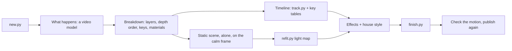

# AnyVFX: one clip to one shader

You are recreating a short effect clip as one fragment shader: `mainImage`, WebGL2 / GLSL ES 3.00, no textures, no
buffers. The order below is the one that worked on the four clips in `examples/`, with the detours removed. Each
step names its command and what to take from it. The first clip took over 40 build-and-look rounds because none of
this existed; the second's first pass took 8.

Shaders are written against the [shader-skills](https://github.com/gokayfem/shader-skills) library: call `fbm`,
`voronoi`, `sdSegment`, `hash32` and the rest by name and the bundler inlines them. Read its `SKILL.md` for the
library and the GLSL rules; this file is only about matching a clip.



All commands run from the repository root with the project's Python (`python` below; see README, Quick start).
`<clip>` is the clip's work folder, for example `work/my-clip`.

## What never to claim

- **Never call the result exact.** Report the measured error (`MAE`, 0-255, full resolution and 8x downsampled)
  and say which parts are measured and which are procedural stand-ins. Do not put a number on something that was
  not measured.
- **Say what you looked at.** Stills cannot show shake, flow or flicker. If only stills were checked, say so.
- **A review covers the files it was run on.** If the shader changed afterwards, the review is out of date.

## 0. Start (10 seconds)

```bash
python tools/new.py <clip> path/to/clip.gif        # or an https:// URL of a GIF
```

Extracts frames, writes `meta.json`, `analysis/`, the scaffold `shader.glsl` (it already compiles) and `scene/`,
the folder the static scene is painted in. Nothing in this step needs a decision.

## 1. Read before writing (one round)

**What happens comes from watching the clip, not from stills.** Give the original `source.gif` to a model that
ingests video natively and ask: camera, what each object does per frame, each effect's onset, peak and decay, what
each effect is made of, depth order (what passes in front of, behind or through what), and the loop seam. Number
the frames in the question (frame N starts at `(N - 1) * dt`), or its frame numbers will drift. If no such model is
available, say so and work from `analysis/sheet.png`, stating that the motion was read from stills.

Then check its answer against the frames. It is good at order of events and bad at where things are: its positions
were off by 20-40 px, it described three bursts in three places as one central splash, and it read a pour of powder
striking a ring of beads as a water splash. **Take what happens from it, and where it happens from the frames.**

Take the **measurements** from the tools. These are for numbers only:

1. `analysis/ANALYSIS.md`: timing, the exposure key (already pasted into the scaffold as `K_AMB`), the drift floor,
   the loop seam, palette, vertical ramps, block colours.
2. `analysis/change.png`: bright = animated. Everything dark is the static scene.
3. `analysis/grid_01.png` (and `_02`, `_03`): full-size frames with pixel rulers. Read positions off these.
4. `analysis/sheet.png`: an index for picking which frames to measure.

## 2. Write the breakdown as comments at the top of the shader (no code yet)

Four lists. This is the step that prevents rework.

- **Layers, back to front.** One line each: what it is, how it is drawn (gradient, silhouette profile, polyline,
  2D SDF, small raymarched SDF, particles).
- **What each effect is made of.** Energy (beams, rings, magic light), water, powder and dust, sparks. The recipe
  differs (step 6), and one clip can hold several.
- **Depth order of every effect.** What is it in front of, what hides it, and does it pass *through* anything. An
  effect that passes through an object is composited after that object with a visibility mask (see `vis` and
  `gPart` in `examples/01-salt-flat-beam`), never simply drawn before it. That example got it wrong first and it
  was the first thing noticed.
- **Keys.** Every quantity that changes per frame gets a `K_*[NF]` table: positions, scales, radii, intensities.

## 3. The static scene, alone, against the calm frame

The scene is painted in `<clip>/scene/`: `env.glsl` defines `vec3 environment(vec2 P, float px)`, and
`scene/shader.glsl` is a harness that draws only that, with a locked camera and no effects. The effect shader
includes `scene/env.glsl`, so nothing is copied back. The scene and the effect are independent work and can be done
in parallel (by two agents: tell the scene worker it owns `scene/env.glsl` and the `lightmap` entry of
`scene/meta.json`, and nothing else).

Pick the **calm frame**: the one with the least effect on it. It is often the last frame, not the first.

```bash
python tools/go.py <clip>/scene --frames 12
python tools/grid.py <clip>/scene 12                        # signed error per 48 px block: too bright / too dark
python tools/crop.py <clip>/scene 12 x0,y0,x1,y1 2          # zoomed reference | render: the main instrument
python tools/probe.py <clip>/scene 12 "x,y x,y ..."         # exact colours, reference vs render
```

- **Trace landmarks, do not invent them.** List every landmark (each wall, slab, trunk, rock, seam, light), most
  visible first, with a note of what belongs to the effect so it is not judged. Crop each at zoom 2-3 on the calm
  frame, and type its outline in as measured points and its colours from `probe.py`. A noise pattern "in the style
  of" the scene is what reads as a stand-in.
- **Big shapes first**: gradients, silhouettes, hero outlines. No texture until `grid.py` shows no block worse than
  about 20 outside the hero.
- **Type colours from `probe.py`, not from looking.** An image viewer makes everything read 20-40 levels lighter
  than it is; the first example's bowls were painted three times too bright because of it.
- **Painted objects are not physically consistent.** Do not solve for one camera: give each hero object its own
  orthographic view (centre, radius, tilt) and place it in pixels.
- **Painted shading is zones, not lighting.** Drive tone from position on the form (height, side) plus noise and
  per-cell flat offsets (`voronoi` + `hash12`); use the normal only as a small term.
- **Soft painted edges.** Zones of light and shade blend over 20-50 px and are broken by leaf- or scuff-scale
  dapples on both sides. A hard edge reads as a cut-out.
- **Draw past the frame.** The camera shake asks the scene for points up to about 30 px outside the frame and rolls
  it a little. Every static shape must be defined at least 30 px beyond the frame, or its edge shows on impact
  frames (`examples/03-forest-geysers`' tree lost its top on the burst).
- **`fbm` is signed** (about -0.7 to 0.7). A threshold written for a 0..1 noise shows nothing.

## 4. Light map (one command, repeatable)

The broad tone of a painted scene is not derivable from its geometry, so it is measured: a coarse grid of colour
gains fitted to the calm frame. Add to `<clip>/scene/meta.json` the region and what to ignore inside it:

```json
"lightmap": {"frame": 12, "rect": [0, 0, 816, 816], "nx": 17, "ny": 17,
             "masks": [[cx, cy, rx, ry]], "boxes": [[x0, y0, x1, y1]]}
```

```bash
python tools/refit.py <clip>/scene
```

It renders the scene with `LIGHTMAP 0`, fits the gains, writes `scene/lightmap.glsl`, rebuilds. Run it again
whenever the scene under it changes; never paste the array by hand. Do it after the big shapes and before fine
texture.

- Mask out everything the effect touches on the calm frame (`boxes` for beams and smoke, `masks` for round hero
  objects), or the effect's light is baked into the scene.
- Exclude a hero object's box from the fit and draw it after the light map so it keeps its probed colours.
- A finer grid (17 x 17) helps a scene whose character is painted light (a dappled forest floor); keep the
  procedural ground quiet under it.
- **Say so when reporting**: the light map is measured from the reference. Everything finer than its grid is
  procedural.

## 5. Timeline (2 rounds)

```bash
python tools/track.py <clip> name:x0,y0,x1,y1 other:x0,y0,x1,y1
```

Boxes are the rigid parts in frame 1. Paste the printed `K_*_DX/DY/SC` tables. Where the score drops below about
0.5 the part is covered by effects; smooth those keys by eye from the grid sheets. Check static-looking objects
too: the first example's bowls rose 80 px and it was not obvious from the sheet.

Effect keys (radius, centre, intensity per frame) are read off `analysis/grid_*.png` into tables. `clamp` every
envelope after `key()`.

- For anything round, measure instead of reading: mean brightness in rings around the centre, per frame, gives the
  ring radius and the glow falloff directly (`examples/02-vortex-bay`'s shock ring: 288, 376, 404 px).
- **If the loop is not seamless** (`ANALYSIS.md` loop seam well above the drift floor), do not wrap the spline:
  clamp the key indices so the shader cuts where the clip cuts (see `key()` in `examples/02-vortex-bay`). Wrapping
  invents a transition that is not in the reference.
- Several effects in sequence: one key table and one start time per burst.
- A ribbon that leaves the floor is a sampled parametric curve `(radius, height, angle)(s)` with the
  nearest-segment distance; get the path right with a thin line first, then width, strokes and glow.
- A curve with near-vertical flanks (a spike in a waveform) needs a true distance: walk it as a short polyline
  round the pixel (`waveDist` in `examples/04-foundry-waveform`). Dividing the vertical gap by the slope glows far
  above the tip.

## 6. Effects at the peak frame, then the rest (3-5 rounds)

```bash
python tools/go.py <clip> --frames 1,<peak>,<late>
python tools/sheet.py <clip> 1,<peak>,<late> name [x0,y0,x1,y1]
```

- Measure the effect's light on the scene: probe the same ground points at rest and at the peak. In the first
  example it was additive violet, not a brightness multiply.
- Probe hero objects at the peak as well; they usually change far less than the glow suggests.
- Additive effects first (glow, rings, beam), then alpha-composited ones (debris, water, dust), then the highlight
  roll-off.
- Every bounded effect needs a window that fades to zero inside its bounding box, or the box shows.
- **Additive glow on dark ground reads as coloured shadow.** A ring's halo on shaded grass looked like a slab of
  blue shadow. Keep halos narrow and faint, and check effects again after the ground under them changes tone.
- **Changing a boundary the effects use as a mask moves the effects.** Look at the peak frame after such a change.

### House style (apply from the first pass)

A shader built only from measured keys comes out rigid. These are deliberate departures from the reference that
make it read as alive; they were asked for on every example. Rules 1, 2, 6 and 7 apply to every clip. Rules 3, 4
and 5 are the recipe for **energy**; water and powder have their own below. The scaffold carries the kit
(`jitter2`, `flick`, `strands`, `motes`, the shake block, `SHAKE`, `PARTICLES`) and a recipe comment in `mainImage`.

1. **Camera shake.** The frame rattles with the effect's energy and settles as it dies: a rattle near 18 Hz on a
   sway near 7 Hz, a hair of roll, plus line boil at 12 Hz. Applied to `P` before anything reads it. `SHAKE` scales
   it; 0 locks the camera. About 13 px at the peak for a violent effect; **look at the reference's own camera first
   and scale to it** (`examples/04-foundry-waveform`'s is nearly still, so it uses about half).
2. **Free particles.** Debris, shards and sparks are ballistic: own heading, own speed, drag, gravity, spin. They
   scatter well outside the effect, land, and stay where they fall. Never ride them on an envelope or a cluster
   centre. Draw each as the path it covered in the last moment (the same trajectory evaluated slightly earlier),
   so it reads as a streak and can be followed; cap the streak's length, and cull by its bounding box before the
   expensive part.
3. **Energy: strip and particles together.** A smooth gradient alone reads as a rigid strip; particles alone lose
   the body and turn to noise. Draw the continuous strip (crisp shape, stroke gaps, a hairline spine), then add
   dashes inside the same shape with `strands()` sheets running in thin lanes along the flow. Round `motes()` are
   only for loose grains shed outside the shape.
4. **Energy: thin and saturated, not wide and white.** Strips are narrow (a ribbon about 20 px at its widest, a
   ring edge a few px) and carry the scene's hue; white is only the hairline spine and the core. Additive light
   blows out to white fast, so keep white terms small (about 0.2) and let the hue terms carry the brightness.
5. **Energy: particles at a quarter.** `PARTICLES 0.25`: the dashes are an accent on the strip, not the main
   event. It is a direct multiplier on the particle layer only (1 = full overlay, 0 = strip alone).
6. **Nothing is steady, but nothing strobes.** Every envelope times its own `flick` at 5-8 Hz and about +-12%;
   centres and loose objects get `jitter2`; edges get lopsided wobble that drifts. Above about 10 Hz it strobes.
7. **Flow must survive the GIF.** A dash has to move less than its own length per reference frame, or the exported
   GIF shows boiling noise. `strands()` already stretches and slows for this; do not undo it.

Controls belong at the top as `#define`s, each a plain multiplier, so "make it 25%" is one number. Do not hide a
scale factor between the control and its use.

Because these depart from the reference, the error can go up. Report it; do not tune it away.

#### Water (`examples/03-forest-geysers`)

Drawn with the energy recipe, water did not read as water at all, then read as ice. What fixed it:

- **A body, not a light.** Water is alpha-blended over the scene, not added: pale where thin, deeper blue where
  thick, white foam at edges, tips and the root, thin glints along the flow, a little glow. See `water()`.
- **A fan, never a lone line.** A splash is many thick rounded tongues in overlapping fans, wide and low at the
  sides (the crown), tall in the middle. A single thin strip coming out of a splash looks wrong even where the
  reference has a thin streak there: break it into a string of beads on the same arc (`beadArc`).
- **It rises, curls and falls.** Fixed shapes that grow and shrink read as ice. Tongues lean outward and droop as
  the burst ages; a few long streams are drawn with every bit of water on its own ballistic path, so the root lets
  go when the throwing stops. Drive these from the burst's **start time**, not an intensity key; keep the per-frame
  keys for glow, froth and shake.
- **Lots of droplets.** About 180 beads per burst, thrown fast and wide all through the burst, mostly fine with a
  few fat ones, each a round bead with a darker rim and a catch-light. Add fine spray over the crown and a white
  boiling mass at the root.
- **Sheets tear.** A wide sheet of water has a ragged outline and breaks into holes as it thins.

#### Dust, smoke and powder (`examples/04-foundry-waveform`)

- Not light either: a pale haze laid over the scene, lit by the effect near it, rising and drifting. Soft
  thresholds on the noise; a hard threshold gives wormy, curly shapes.
- Put some of it **in front of** the effect late in the loop, so a dying effect sinks into it.
- A drawn line of energy is not a ruled curve: push it about with slow turbulence, vary its thickness and
  brightness along its length, and tear secondary strands instead of repeating the main one as a neat pattern.

## 7. Publish

```bash
python tools/finish.py <clip> [--open]
```

Full render with the error per frame, a sheet of the frames (`out/all.png`), `shader.gif`, `compare.gif` and
`compare.html` (the reference GIF beside the live shader). `shader.out.glsl` is the paste-ready Shadertoy code.

To rework something already published, keep the proof first: `python tools/baseline.py <clip>` copies the published
GIFs and sources into `baseline/`, and after the rework and another `finish.py`,
`python tools/beforeafter.py <clip> <frame>` writes reference | before | after.

## 8. Check the motion (before saying it works)

Stills cannot show shake, flow or flicker, and a GIF at reference rate aliases all three. This step reads the
files step 7 just wrote, so always publish first; reviewing a stale `compare.gif` is reviewing the wrong shader.

```bash
python tools/capture.py <clip>      # live.mp4: reference | live shader at 60 fps, 3 loops (needs ffmpeg)
```

- Give `compare.gif` to the video model for the reference-rate verdict (does the flow boil, does the flicker
  strobe, popping at the seam, does each material read as what it is). Number the frames in the question.
- A model that samples about one frame per second **cannot** judge 60 fps motion and will call a real shake
  "locked". Measure instead: render with `--define SHAKE=0.0 --tag _ns` and compare a static region against the
  normal render, per frame.
- What is left (does the flow read, does the shake feel like an impact) is the user's call on `compare.html`. Say
  so plainly instead of claiming it was verified.
- Anything changed as a result: run step 7 again so the published files match the shader, and remember the review
  no longer covers them.

## Rules that cost time when broken

- Shader edits: no `smoothstep` with decreasing edges (lint error; use `ramp` or `1.0 - smoothstep`), no sine
  hashes, float literals everywhere, `half` is a reserved word, never `pow(x, 2.0)` on a value that can be negative
  (undefined in GLSL ES; use `sq`).
- Call library functions by name; the bundler inlines them. Search with shader-skills' own tool, in your checkout
  of it (`SHADER_SKILLS`, or the sibling `../shader-skills`):
  `python ../shader-skills/skills/shader-art-coding/scripts/glsl_tools.py search <words>`.
- Judge by numbers and side-by-sides rendered through the same path, never by a single image.
- **Re-measure the final file.** Run `go.py` and `grid.py` on the calm frame after the last tweak; a fix that was
  not re-measured is not a fix.
- **Frame time printed by `go.py` is noisy** (the first render after a build includes compiling, and other
  renders running at the same time inflate it). Compare old and new back to back over several renders before
  saying something got slower.
- Error will not go below the drift floor in `ANALYSIS.md` plus the cost of unmatched painted texture. Chase
  structure the eye sees, not the last point of error.

## What is still manual

Choosing the layer list, reading effect keys off the grid sheets, and painting the hero objects. Those are the
judgment calls; everything around them is one command.
