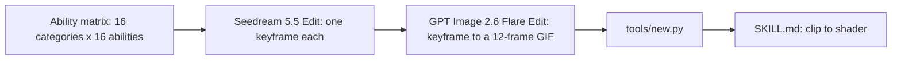

# Where the reference clips come from

AnyVFX starts from a GIF. This page is the step before that: how clips like the ones in [`examples/`](../examples)
are made. It separates two things. The **workflow** (ability matrix, keyframe, image-to-GIF) is what was run, and
is what to repeat. The **lineage** of each example clip (which keyframe became which GIF) is not on record, and is
only matched after the fact; see "The four examples". You do not need any of this to use the tools:
`tools/new.py` takes any GIF.



The settings and prompts below were read back from the author's fal request history. Nothing here is a media
file; the four example clips themselves are in `examples/*/source.gif`.

## Stage A: a keyframe per ability (Seedream 5.5 Edit)

- Endpoint: `bytedance/seedream/v5.5/edit` on [fal](https://fal.ai).
- Input: `image_size` 1024 x 1024, `output_format` `png`, one attached image, and the prompt below.
- One batch of **256 requests** (16 categories x 16 abilities), sent within seven minutes. Median time per image:
  23 s.

Every prompt in the batch is the same template with six slots. The text after the last slot is identical in all 256:

```text
Create the defining active keyframe of {ABILITY}, a {CATEGORY} game ability. {ACTION} Depict the most legible
instant of that action. Stage it in {SETTING}. Use {STYLE}. Use a {CAMERA}. The attached image provides the
quality bar for readable layered particles; design an original composition for this ability and its setting. Make
the force direction immediately visible through spacing, silhouette and secondary debris. Keep the complete ability
inside the square frame. Let the background establish the surface and light without competing with the action. No
characters, equipment showcase, UI, words, borders or multi-panel layout.
```

(Each prompt was sent as one line; it is wrapped here.)

What the slots do:

- **ACTION** is one sentence that names shapes and a sequence, not a mood: "A tight column of water punches upward
  through a circular seal and mushrooms at its apex." This sentence is what makes the later animation readable.
- **SETTING**, **STYLE** and **CAMERA** are drawn from short fixed lists (below), so the batch covers looks and
  viewpoints evenly: each style is used 32 times and each camera 64 times.
- **The attached image** is a small crop offered only as "the quality bar for readable layered particles". The
  prompt tells the model to design an original composition, not to copy it.
- The closing constraints keep the effect whole and alone: complete inside a square frame, background present but
  quiet, no characters, UI, words, borders or multiple panels.

### The lists

Categories (16 abilities each): alchemy and status, tech and energy, light and restoration, space and time, shadow and spirit, arcane geometry, sound and rhythm, earth and growth, stealth and traps, storm and wind, boss telegraphs, frost and tide, movement and traversal, firecraft, impact arts, blade arts.

Styles:

- bold pixel-art VFX, deliberate chunky pixel clusters and limited ramps
- hand-painted isometric RPG particles with layered translucent brush edges
- high-contrast anime action smear; broad tapered strokes and crisp impact accents
- stylized 3D action-game particles with clean silhouettes and depth falloff
- cel-shaded arcade animation with hard two-tone shadows and minimal bloom
- tactile cinematic volumetrics with physically grounded contact light
- graphic ink-wash fantasy FX with dry-brush breakup and sparse luminous accents
- retro vector arcade rendering with bright contour lines and sparse granular decay

Cameras:

- fixed high oblique view with strong ground separation
- fixed orthographic action-game view
- fixed low side-on view with a clear horizontal motion plane
- fixed three-quarter gameplay view

Settings:

- a copper foundry floor under diffuse orange furnace light
- a violet alien salt flat with distant flat mesas
- a pale dawn skybridge of worn limestone above low cloud
- a rain-dark slate courtyard with teal reflected skylight
- a moss-covered forest clearing in dappled afternoon light
- a celadon bamboo training court with light horizontal ground texture
- a snowy blue-hour pass with wind-combed snow
- an abandoned navy-blue orbital hangar with spare amber floor insets
- an underwater cobalt grotto with soft caustics
- a plum-black void above a faint matte basalt floor
- a moonlit marsh of shallow jade water
- a sunlit ochre desert arena with a softly rippled sand floor
- a desaturated pink rooftop at sunset with a soft distant skyline
- a museum-quiet ivory marble hall with broad soft shadows
- a dark stained-glass chapel floor with restrained bands of reflected color
- a red clay canyon floor under hard side light

The full matrix, with every ability's action sentence, is in [`clip-batch.md`](clip-batch.md).

### Earlier wordings

The same day, before the batch, 32 requests on the same endpoint tried other openings:
"Create a production still for a stylized fantasy game effect ..."; "Render the active hit frame ...". The template above is the one the batch used.

## Stage B: keyframe to clip (GPT Image 2.6 Flare Edit)

- Endpoint: `openai/gpt-image-2.6/flare/edit` on fal.
- Output: an animated GIF. The four examples are 816 x 816, 12 frames, 0.12 s per frame (a 1.44 s loop).
- **288 GIFs** were made the same morning, between 08:54 and
  09:16 UTC. Median time per clip: 24 s.

**What is not known.** The request history does not keep the inputs of these requests, so the prompt and settings
that turned a keyframe into a clip are not on record, and they are not reproduced here. That the clips were made
from the Stage A keyframes is inferred from their content and timing, not read from the requests.

## The four examples: candidate source prompts

No request links a keyframe to a clip, because Stage B's inputs are missing. These are **candidates**, and they
were not found by searching all 256 keyframes. Each was shortlisted by subject and setting from the prompt text,
then its keyframe image was compared with the clip's frames. For 01, 03 and 04 one prompt was shortlisted; for 02
the sixteen prompts staged in its setting were ranked. "Match" says how good the result is. Treat them as
probable, not as verified lineage.

| Example | Candidate ability | Action | Setting | Style | Camera | Match |
|---|---|---|---|---|---|---|
| [`01-salt-flat-beam`](../examples/01-salt-flat-beam/NOTES.md) | **Harmonic Lift** (sound and rhythm) | Three standing waves stack vertically and raise a halo of floating grains between their crests. | a violet alien salt flat with distant flat mesas | cel-shaded arcade animation with hard two-tone shadows and minimal bloom | fixed high oblique view with strong ground separation | scene and subject match |
| [`02-vortex-bay`](../examples/02-vortex-bay/NOTES.md) | **Final Rest** (sound and rhythm) | A broad ringing wave collapses toward a fixed point while stray oscillations damp one by one. | an abandoned navy-blue orbital hangar with spare amber floor insets | retro vector arcade rendering with bright contour lines and sparse granular decay | fixed high oblique view with strong ground separation | likely: closest of the 16 keyframes staged in this setting, by a small margin |
| [`03-forest-geysers`](../examples/03-forest-geysers/NOTES.md) | **Pressure Geyser** (frost and tide) | A tight column of water punches upward through a circular seal and mushrooms at its apex. | a moss-covered forest clearing in dappled afternoon light | high-contrast anime action smear; broad tapered strokes and crisp impact accents | fixed low side-on view with a clear horizontal motion plane | by subject and setting only; the clip's composition differs from the keyframe |
| [`04-foundry-waveform`](../examples/04-foundry-waveform/NOTES.md) | **Reverb Tail** (sound and rhythm) | A single sharp strike leaves progressively wider, weaker offset silhouettes of its waveform. | a copper foundry floor under diffuse orange furnace light | tactile cinematic volumetrics with physically grounded contact light | fixed low side-on view with a clear horizontal motion plane | scene and subject match closely |

Two things follow for the shaders. The clip is the reference, not the keyframe: the animation step redesigns freely
(example 03's clip has three bursts and four rings where its keyframe prompt describes one column of water). And
the style words explain what the scene painter is up against: "hand-painted", "ink-wash" and "cinematic volumetrics"
are the painted texture the shaders do not reproduce.

## Optional: a camera-by-time sheet from a finished clip

One later Flare request (the only one of these whose input is on record) tried the reverse direction: from a clip,
a sheet that shows the same effect from four cameras at four moments, to help understand its three-dimensional
layout before writing the shader. It was run once, on example 01, and was not used for the published shader.

- Endpoint: `openai/gpt-image-2.6/flare/edit`, `image_size` 2880 x 2880, `quality` `high`, `reasoning_effort`
  `high`, `num_images` 1, `output_format` `png`.
- Two attached images: a labelled 3 x 3 contact sheet of nine frames, and the peak frame.

The prompt, in full. The "IMMUTABLE SCENE" block is specific to example 01; the rest is the reusable structure
(inputs, columns as time, rows as cameras, what must stay identical).

````text
Create ONE square VFX reconstruction reference sheet: exactly 4 rows by 4 columns, 16 equal square panels separated by narrow dark gutters. This is a camera-by-time matrix of ONE consistent three-dimensional scene, not 16 redesigns.

INPUTS
Image 1 is a labeled 3x3 contact sheet of nine chronological frames from one animation. Its labels are reference metadata, not artwork to reproduce. Image 2 is the original peak frame (0.60 seconds) for close inspection of materials and shapes. Study both. Do not copy the input's 3x3 layout.

IMMUTABLE SCENE
Reconstruct the same THREE separate, thick-walled, irregular faceted lavender stone bowls, coaxial on one vertical axis. Largest bowl rests on the rocky ground. Medium bowl floats above it. Smallest bowl floats highest. Both suspended bowls have visible air gaps beneath them. Match their silhouettes, chipped rims, thickness, relative sizes and vertical spacing to the source. Keep the identical bowl geometry and positions in every panel. They must never become one bowl, a telescoping stack, a continuous pedestal or a fountain with a central solid stem. All three remain present even where a real camera angle occludes a surface. Preserve the violet central energy column, violet-white light, rough stone materials and purple rocky ground. Use a dim uncluttered purple environment so the effect reads clearly. Keep light direction fixed in world space.

COLUMNS ARE TIME; REPEAT THIS SAME FOUR-PHASE SEQUENCE IN EVERY ROW
Column 1 = CHARGE at 0.12s, reference tile 02: three bowls, soft vertical violet light, sparse motes; no expanded horizontal shockwave rings.
Column 2 = BURST at 0.36s, reference tile 04: two horizontal expanding annular shockwaves at two different heights, rising fragments and a brightening energy column. Rings are still relatively compact.
Column 3 = PEAK at 0.60s, reference tile 06 / Image 2: the same TWO shockwaves expanded farther outward, bright ragged rims, translucent turbulent bands, abundant suspended fragments and stronger light. Preserve the source's scale and silhouette. No extra rings.
Column 4 = DECAY at 0.96s, reference tile 08: expanded bright rings have disappeared; only fading central light, a few falling fragments and residual wisps. It must visibly be quieter than column 3, with unchanged bowls.

ROWS ARE CAMERA POSITIONS; WITHIN A ROW THE CAMERA NEVER MOVES
Row 1, all four columns: FRONT view, source azimuth 0 degrees, elevation +25 degrees. Match the original viewing direction.
Row 2, all four columns: RIGHT SIDE view, azimuth +90 degrees, elevation 0 degrees. Camera looks horizontally at the middle bowl; rims and horizontal shockwaves are nearly edge-on. This row must NOT look down into all three bowls.
Row 3, all four columns: REAR LOW view, azimuth 180 degrees, elevation -10 degrees. Camera looks slightly upward; show the undersides of suspended bowls and the opposite stone faces. Do not show the same interior-heavy front view.
Row 4, all four columns: HIGH THREE-QUARTER view, azimuth 270 degrees, elevation +65 degrees. Look steeply downward: large visible bowl interiors and nearly circular horizontal shockwaves. Natural overlap is correct; do not merge the actual objects.

Keep the full effect and ground contact inside every panel with enough margin for peak rings. Use the same camera distance and focal length across each row. Allow physically correct perspective changes between rows. Every column must depict the identical instant, particle arrangement and wave radius seen from four cameras, not four different simulations. Show spatially deep translucent turbulence and solid fragments, not flat pasted glows or opaque white disks. Favor accurate source geometry and unmistakable camera/phase differences over extra ornament. No labels, numbers, arrows, text, watermarks, extra panels or inset frames in the final sheet.
````
