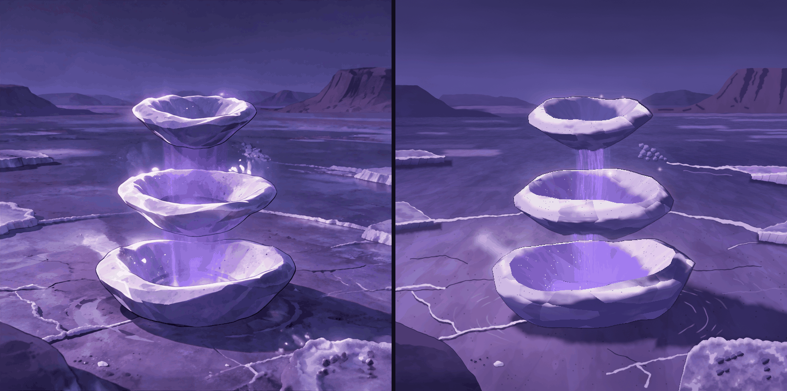

# 01 Salt-flat beam

Three faceted stone bowls float over a violet salt flat. An energy beam fires through their centres, two rings
expand, debris flies, and the scene settles. 816 x 816, 12 frames, 0.12 s per frame.

Error over all frames: **23.8** at full resolution, **21.1** after an 8x downsample (0-255 per channel). The calm
frame (frame 1) alone is 16.6.

## What is measured

- The bowls' motion: tracked with `tools/track.py` and typed in as key tables. They rise about 80 px during the
  burst, which was not obvious from the frame sheet.
- The timeline: one key per reference frame for the beam, rings, debris and exposure.
- The scene's landmarks, traced from frame 1: both mesas (outline and gullies), the far hills, the distant flats,
  four salt slabs, the white ridges between them, the foreground rock, the salt mound and its pebbles, the shadow
  wedge beside the stack.
- The light map: 9 x 7 colour gains over the plain, fitted to frame 1 with the bowls and beam masked out.
- The effect's light on the ground: additive violet, measured by probing the same points at rest and at the peak.

## What is a stand-in

- The bowls' shading. Each bowl is a small raymarched shape with its own orthographic view; its tone is painted
  zones, not lighting.
- Debris, sparks, the dashes inside the beam and rings, and the camera shake (up to 13 px, measured on the shader;
  it is a house-style addition, not a measurement of the reference).

## What still does not match

- The bowls are the largest source of error: blocks next to them are off by up to about 50 levels.
- The plain is smoother than the reference's brushwork and has no clearly drawn plates.
- The small rock pile reads as round blobs; the mound's pebbles read as dots.
- The pale sheen left of the stack is a soft smudge, darker than the reference's.

## How it was built

This was the first clip, built before the scene was split from the effect: the scene, the light map and the effect
all live in `shader.glsl`, and `lightmap.glsl` sits beside it (`python tools/refit.py examples/01-salt-flat-beam`).
The beam passes through the bowls, so it is composited after them with a visibility mask (`vis`, `gPart`); drawing
it behind them was the first mistake noticed.
