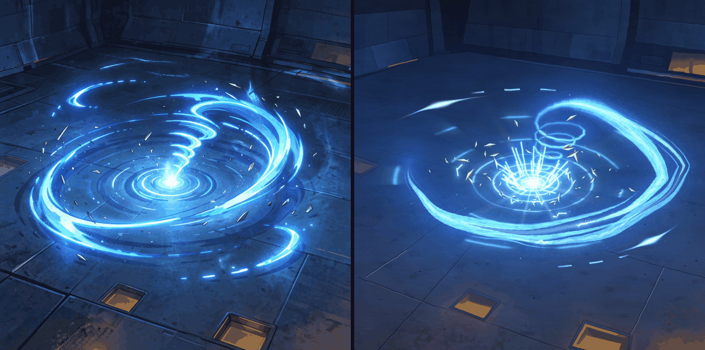

# 02 Vortex bay

A blue energy vortex on the steel floor of a dark bay. It opens as a twisting fountain whose ribbon flares out and
falls to the floor, becomes an expanding shock ring, and dies back to ripples, sparkles and an ember. 816 x 816,
12 frames, 0.12 s per frame.

Error over all frames: **15.6** at full resolution, **13.9** after an 8x downsample (0-255 per channel). The calm
frame (frame 12) alone is 6.6.

## What is measured

- The timeline. The clip does not loop seamlessly (frame 1 is the full burst, frame 12 the bare room), so the key
  spline does not wrap: `key()` clamps its indices and the shader cuts where the clip cuts.
- The shock ring's radius per frame (288, 376, 404 px), from mean brightness in rings around the centre.
- The scene's landmarks, traced from frame 12: the wall/floor boundary, the left wall's stepped panels and trim,
  the corner recess, the pillar, the centre wall's seams and hatch, the lit window, fifteen floor seams, both
  recessed floor lights and a third at the left edge.
- The light map: 9 x 9 colour gains over the whole frame, fitted to frame 12.

## What is a stand-in

- The fountain ribbon: a sampled parametric curve, shaped by eye against the frames.
- Shards, sparks, crackle, sparkles, the dashes in the ring, and the camera shake (up to 10 px, measured on the
  shader; a house-style addition).
- Floor texture: scuffs, stains and scratches are procedural.

## What still does not match

- **The right floor light is about 28 levels too dark** on frame 12. It is the worst block on that frame.
- The floor plates are smoother and lower in contrast than the reference; its dark stains and wet sheen are only
  hinted at.
- The wall panels are flatter than the painted ones, and the window's surround has less detail.
- The reference's ring is one bright continuous band; the shader's is thinner and broken into dashes, by choice
  (see "House style" in the README).

## How it was built

Scene, light map and effect all live in `shader.glsl`, with `lightmap.glsl` beside it. The wall/floor boundary is
also a mask some effects use, so moving it moves them: check the peak frame after touching `wallY`.
