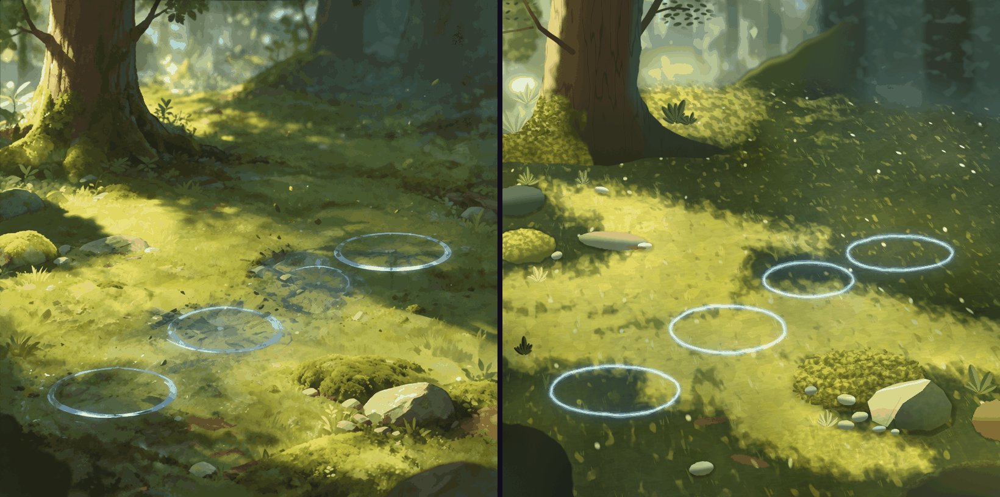

# 03 Forest geysers

A sunlit forest clearing with four glowing blue rings on the grass. Water bursts out of them in turn: lower left,
centre, then a big one on the right that throws a wide curved sheet up out of frame. 816 x 816, 12 frames, 0.12 s
per frame.

Error over all frames: **24.8** at full resolution, **21.7** after an 8x downsample (0-255 per channel). The calm
frame (frame 12) alone is 19.2. The worst frames are 7 and 8, where the big burst covers the scene.

## What is measured

- Where and when each burst happens, from the frames. A video model described the three bursts as one central
  splash; the positions here come from measurement.
- The rings' positions and sizes, and one intensity key per ring and per burst.
- The scene's landmarks, traced from frame 12: the big tree (outline, roots, branches), the far trunks, the back
  edge of the clearing, the pools of sunlight, the moss mound, the rock and its pebbles, the boulders at the left.
- The light map: 17 x 17 colour gains over the whole frame, fitted to frame 12 with the rings masked and the trunk
  excluded. This scene's character is painted light, so it leans on the map more than the others.

## What is a stand-in

- All of the water: the fans of tongues, the ballistic streams, the big sheet, about 180 droplets per burst, the
  strings of beads. It is drawn as a translucent body laid over the scene, not as light.
- The rings' dashes and the camera shake (house-style additions).
- Bark, moss, grass tufts, flowers and leaf litter are procedural texture.

## What still does not match

- The bursts have crisp, pointed tips where the reference has ragged foam, and the second burst is small and thin
  next to the reference's.
- The reference has a thin arcing streak on bursts 1 and 2. A solid line there looked wrong, so it is a string of
  beads instead.
- The hazy foliage behind is smoother than the reference; the sun pools only roughly follow the real dapples; the
  mound and rock are simpler than the painting; the back-right floor is flat dark green where the reference has
  stones and leaf litter.
- **The last motion review is older than the final file.** It was run before the last particle and scene changes;
  those were checked on stills only.

## How it was built

The first water was drawn with the recipe for energy (additive strips with dashes) and did not read as water at
all, then read as ice. `water()`, `geyser()`, `sheet()`, `droplets()` and `beadArc()` are what replaced it; the
"Water" section of `SKILL.md` is the lesson. The scene was rebuilt afterwards from traced landmarks; every static
shape is defined past the frame edge because the camera shake looks there.
