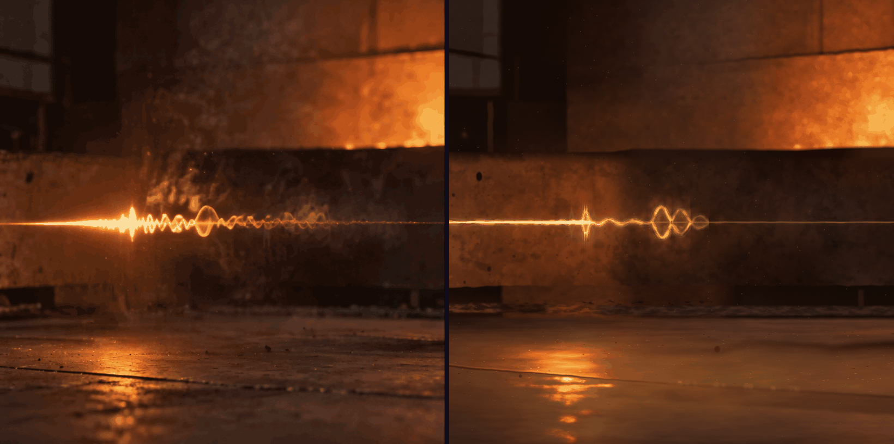

# 04 Foundry waveform

A glowing orange waveform fires along a line in a dark foundry hall: a tall spike, ripples either side of it,
lens-shaped lobes to its right, sparks, and dust that the dying wave sinks into. 816 x 816, 12 frames, 0.12 s per
frame.

Error over all frames: **17.4** at full resolution, **16.2** after an 8x downsample (0-255 per channel). The scene
alone, against frame 1, is 8.0.

## What is measured

- The waveform: the spike's position and its height per frame, the lobes' start, length and amplitude per frame,
  and brightness keys for the spike and the wave. The clip does not loop seamlessly, so the keys do not wrap.
- The scene's landmarks, traced from frame 1: the window frame and dark opening, the furnace-lit panel with its
  seams and embers, the concrete block with its holes and runs, the base strip and rubble, the floor's crack,
  second seam and reflection.
- The light map: 17 x 17 colour gains over the whole frame, fitted to frame 1 of the scene alone, with the line,
  its glow and the smoke boxed out. The warm reflection on the floor at rest is left in the map.

## What is a stand-in

- Sparks (900, ballistic, a mix of ember dust and long streaks), dust, the second torn strand, the turbulence that
  pushes the line about, the light on the hall and the streak on the floor.
- Camera shake at about half the usual strength. The reference camera is nearly still; a motion review thought it
  jitters slightly at the peak, and neither was measured.

## What still does not match

- The lobes are more regular and symmetrical than the reference's.
- The dust reads as drawn in places, and the sparks may be longer and brighter than the reference's finer embers.
- The floor is smoother than the reference's gritty concrete.
- The restart from frame 12 to frame 1 snaps slightly.
- **The last changes were checked on stills only.** Two motion reviews were run; the changes made in answer to the
  second have not been reviewed in motion, and they raised the error from 16.6 to 17.4.

## How it was built

This is the first clip built with the scene split from the effect, which is now the default for new clips:

- `scene/env.glsl` is the static scene, painted alone with a locked camera through `scene/shader.glsl` (a harness)
  and fitted with `python tools/refit.py examples/04-foundry-waveform/scene`.
- `shader.glsl` is the effect. It includes `scene/env.glsl` and `scene/lightmap.glsl`.

The effect is present on every frame of this clip, so the light map could not be fitted against the full shader;
fitting it on the scene alone is what the split is for. The spike has near-vertical flanks, so the distance to the
curve is measured by walking it as a short polyline (`waveDist`).
